# Document Q&A RAG Chatbot with Evaluation Harness

[](https://www.python.org/downloads/)
[](https://docs.pytest.org/)
[](https://opensource.org/licenses/MIT)

A production-grade, modular Python application for **Document Question-Answering (RAG)** featuring an automated **Evaluation Harness** for retrieval accuracy (**Hit Rate@K**, **Recall@K**, **MRR**, **Precision@K**) and generation quality (**Faithfulness**, **Answer Relevance**, **Correctness**).

> [!NOTE]
> 📄 The complete 10-page Technical Project Documentation (HLD & LLD with Architecture Diagrams) is included in this repository: [**`docs/Document_QA_RAG_Project_Documentation.pdf`**](docs/Document_QA_RAG_Project_Documentation.pdf).

---

## 📖 Table of Contents
1. [Project Overview](#project-overview)
2. [High-Level & Low-Level Architecture](#high-level--low-level-architecture)
3. [Folder Structure](#folder-structure)
4. [Core Modules](#core-modules)
5. [Evaluation Metrics & Mathematical Foundations](#evaluation-metrics--mathematical-foundations)
6. [Getting Started & Installation](#getting-started--installation)
7. [Running the Application](#running-the-application)
8. [Running Automated Tests](#running-automated-tests)
9. [Security and Reliability](#security-and-reliability)

---

## 1. Project Overview

### Problem Statement
Manual document review is time-consuming, and general-purpose LLM chatbots frequently hallucinate unsupported answers or fail to locate precise passages. This project combines:
- **Multi-format Ingestion:** PDF (PyMuPDF with page tracking), DOCX (python-docx), and plain text.
- **Strict Chunk Metadata Schema:** Consistent tracking of document ID, source filename, page number, and chunk index.
- **Dense Vector Retrieval + Optional Reranking:** Embedding with Sentence Transformers / FAISS / NumPy cosine similarity, combined with lexical-semantic fusion reranking.
- **Evidence-Grounded Generation:** Enforces citations and strict model abstention when context is insufficient.
- **Deterministic Evaluation Harness:** Measures retrieval hit rate, recall, MRR, precision, faithfulness, and relevance against golden labeled benchmarks.

---

## 2. High-Level & Low-Level Architecture

### High-Level Architecture (HLD)

```mermaid
graph TD
    User([User]) <--> UI[Streamlit User Interface]
    UI <--> Controller[Application Controller]

    subgraph Ingestion Pipeline
        Upload[Upload PDF / DOCX / TXT] --> Validator[File Validator]
        Validator --> Parser[PyMuPDF / docx Parser]
        Parser --> Chunker[Chunking Engine]
        Chunker --> Embedder[Embedding Service]
    end

    subgraph Storage
        Embedder --> VStore[(Vector Database + Chunk Metadata)]
        Chunker --> SQLite[(SQLite Metadata Store)]
    end

    subgraph Question Answering
        Query[User Question] --> QEmb[Query Embedding]
        QEmb --> VStore
        VStore --> RetCandidates[Top-K Candidates]
        RetCandidates --> Reranker[Lexical-Semantic Reranker]
        Reranker --> PromptBuilder[Grounded Prompt Builder]
        PromptBuilder --> LLM[Gemini API / Local LLM]
        LLM --> AnswerWithCitations[Answer + Verifiable Citations]
    end

    subgraph Evaluation Harness
        GoldenDS[Golden Dataset] --> BenchmarkRunner[Benchmark Runner]
        BenchmarkRunner --> RetMetrics[HitRate@K, Recall@K, MRR, Precision@K]
        BenchmarkRunner --> AnsMetrics[Faithfulness, Relevance, Correctness]
        RetMetrics --> Reports[CSV / JSON / Markdown Reports]
        AnsMetrics --> Reports
    end
```

### Low-Level Architecture (LLD)

```mermaid
classDiagram
    class FileValidator {
        +validate_file(input, filename) ValidationResult
        +generate_document_id(content, counter) str
    }
    class DocumentParser {
        +parse_pdf(file_input, doc_id, doc_name) ParsedDocument
        +parse_docx(file_input, doc_id, doc_name) ParsedDocument
        +parse_txt(file_input, doc_id, doc_name) ParsedDocument
    }
    class Chunker {
        +chunk_size int
        +chunk_overlap int
        +chunk_document(doc) List~ChunkRecord~
    }
    class EmbeddingService {
        +embed_documents(texts) ndarray
        +embed_chunks(chunks) ndarray
        +embed_query(query) ndarray
    }
    class VectorStore {
        +add_chunks(chunks, embeddings)
        +search(query_vector, top_k) List~SearchResult~
        +delete_document(document_id) int
    }
    class Retriever {
        +retrieve(query, top_k) List~SearchResult~
    }
    class Reranker {
        +rerank(query, candidates, top_k) List~SearchResult~
    }
    class AnswerGenerator {
        +generate_answer(question, candidates) AnswerResult
    }
    class RetrievalMetrics {
        +calculate_hit_rate_at_k()
        +calculate_recall_at_k()
        +calculate_mrr()
        +calculate_precision_at_k()
    }
```



---

## 3. Folder Structure

```
document-qa-rag/
├── app.py                             # Streamlit interactive dashboard & multi-tab UI
├── requirements.txt                   # Production dependencies
├── .env.example                       # Environment configuration template
├── README.md                          # Documentation and architecture guide
├── pytest.ini                         # Pytest configuration
├── src/
│   ├── __init__.py
│   ├── ingestion/
│   │   ├── __init__.py
│   │   ├── file_validator.py          # File format, size validation, ID generation
│   │   ├── document_parser.py         # PyMuPDF, python-docx, TXT page extraction
│   │   └── chunker.py                 # Sliding-window chunker with schema conformity
│   ├── embeddings/
│   │   ├── __init__.py
│   │   └── embedding_service.py       # Dense vector encoder with offline fallback
│   ├── retrieval/
│   │   ├── __init__.py
│   │   ├── vector_store.py            # FAISS IndexFlatIP + NumPy cosine similarity
│   │   ├── retriever.py               # Top-K candidate search coordinator
│   │   └── reranker.py                # Cross-encoder & lexical-semantic fusion
│   ├── generation/
│   │   ├── __init__.py
│   │   ├── prompt_builder.py          # Injection-safe grounded prompt assembler
│   │   └── answer_generator.py        # Gemini API / Offline extractive generator
│   ├── evaluation/
│   │   ├── __init__.py
│   │   ├── dataset_loader.py          # Golden benchmark JSON loader & validator
│   │   ├── retrieval_metrics.py       # Deterministic Hit@K, Recall@K, MRR, Precision@K
│   │   ├── answer_metrics.py          # Faithfulness, Relevance, and RAGAS interface
│   │   ├── benchmark_runner.py        # Automated test execution & K-parameter sweeps
│   │   └── report_generator.py        # CSV/JSON export & Markdown summary generator
│   └── storage/
│       ├── __init__.py
│       └── metadata_store.py          # SQLite repository for docs & experiment runs
├── evaluation_data/
│   └── evaluation_dataset.json        # Golden benchmark queries and ground-truth chunk IDs
├── tests/
│   ├── __init__.py
│   ├── conftest.py                    # Test harness configuration
│   ├── test_ingestion.py              # Ingestion, validation, and chunking tests
│   ├── test_retrieval_metrics.py      # Hand-calculated metric verification & edge cases
│   └── test_rag_pipeline.py           # End-to-end integration and lifecycle tests
└── reports/
    └── .gitkeep                       # Destination folder for exported benchmarks
```

---

## 4. Core Modules

### Ingestion & Chunking
- **`file_validator.py`**: Verifies extensions (`.pdf`, `.docx`, `.txt`), file sizes, magic headers, and assigns sequential (`doc01`) or content-hashed IDs.
- **`document_parser.py`**: Extracts text page-by-page using PyMuPDF for PDFs (retaining 1-based page numbers), python-docx for DOCX, and normalized text for TXT.
- **`chunker.py`**: Splits text into passages with configurable `chunk_size` and `chunk_overlap`. Produces chunk records adhering strictly to:
  ```json
  {
    "chunk_id": "doc01_chunk_004",
    "document_id": "doc01",
    "document_name": "guide.pdf",
    "page_number": 5,
    "text": "The system retrieves relevant passages...",
    "chunk_index": 4
  }
  ```

### Embeddings & Vector Store
- **`embedding_service.py`**: Encodes text into 384-dimensional dense vectors using Sentence Transformers (`all-MiniLM-L6-v2`) or deterministic hashing fallback for zero-downtime offline execution.
- **`vector_store.py`**: Supports FAISS IndexFlatIP (cosine similarity) and pure NumPy fallback. Includes `delete_document` to purge vectors and metadata when a document is removed.

### Generation & Abstention
- **`prompt_builder.py`**: Assembles grounded prompts with untrusted-data boundaries:
  ```
  You are a document question-answering assistant.
  Answer using only the supplied context.
  Do not invent facts absent from the context.
  If the context is insufficient, say so.
  ```
- **`answer_generator.py`**: Calls the Gemini API (`google-genai` / `google-generativeai`) or local grounded extractor, producing answers, citation metadata, and latency tracking.

---

## 5. Evaluation Metrics & Mathematical Foundations

Let $N$ be the number of benchmark questions, $R_k$ the top-K retrieved chunk IDs, $G$ the annotated ground-truth chunk IDs, and $r$ the 1-based rank of the first relevant chunk in $R_k$.

### 1. Hit Rate@K
$$\text{HitRate@K} = \frac{1}{N} \sum_{i=1}^{N} \mathbb{I}[R_{k,i} \cap G_i \neq \emptyset]$$
Measures the percentage of queries where at least one ground-truth passage appears in the top $K$.

### 2. Recall@K
$$\text{Recall@K} = \frac{1}{N} \sum_{i=1}^{N} \frac{|R_{k,i} \cap G_i|}{|G_i|}$$
Measures what proportion of all annotated relevant chunks were successfully retrieved.

### 3. Mean Reciprocal Rank (MRR)
$$\text{MRR} = \frac{1}{N} \sum_{i=1}^{N} \frac{1}{r_i}$$
Rewards high-ranked relevant results ($1/1 = 1.0$, $1/2 = 0.5$, etc.). If no relevant result is retrieved, contributes 0.

### 4. Precision@K
$$\text{Precision@K} = \frac{1}{N} \sum_{i=1}^{N} \frac{|R_{k,i} \cap G_i|}{K}$$
Calculates the fraction of retrieved passages that are relevant.

### Edge Case Handling
- **Deduplication:** Repeated chunk IDs in retrieved results are deduplicated while preserving rank order.
- **Missing Labels:** When $|G|=0$, Recall is safely bounded to 0.0 without division by zero.
- **Fewer-than-K results:** Handled strictly according to the formula denominator $K$.

---

## 6. Getting Started & Installation

### Prerequisites
- Python 3.10, 3.11, or 3.12
- Git

### Setup
```bash
# 1. Clone or navigate to the directory
cd document-qa-rag

# 2. Create and activate a virtual environment
python -m venv .venv
# On Windows:
.venv\Scripts\activate
# On Linux / macOS:
source .venv/bin/activate

# 3. Install dependencies
pip install -r requirements.txt

# 4. Optional: Configure your environment variables
cp .env.example .env
```

---

## 7. Running the Application

### Option A: Modern Web UI (Recommended • FastAPI + Vanilla SPA)
Launch the modern, responsive web application (zero-Streamlit, ultra-fast single page interface with dark glassmorphism, dynamic animations, live telemetry, and interactive SVG charts):

```bash
# Using the active virtualenv
python server.py
```

The application opens instantly at [**`http://localhost:8000`**](http://localhost:8000).

#### Features:
1. **⚡ Live Telemetry & System Status:** Real-time indicator for Gemini 3.8 Flash connectivity, indexed document count, chunk count, and vector store backend.
2. **💬 Chat & Q&A:** Natural conversational search with quick prompt chips, markdown rendering, copy-to-clipboard, and expandable audited citations with page numbers and relevance scores.
3. **📑 Knowledge Base Management:** Drag-and-drop document upload (PDF, DOCX, TXT), animated progress bar, document inventory table, and modal chunk inspector.
4. **📊 Evaluation Benchmark Harness:** Interactive evaluation against golden datasets measuring Hit Rate@K, Recall@K, MRR, Precision@K, Faithfulness, and Latency, coupled with an interactive $K \in [1, 3, 5]$ parameter sweep chart and one-click CSV/JSON export.
5. **⚙️ Pipeline Tuning Drawer:** Instant adjustments for Top-K candidates, neural reranking toggle, chunk size, and chunk overlap.

---

### Option B: Streamlit Dashboard (Alternative)
If you prefer running via Streamlit:

```bash
streamlit run app.py
```

Opens at `http://localhost:8501`.

---

## 8. Running Automated Tests

Run the full pytest suite:

```bash
pytest -v
```

All 25 tests (unit tests for ingestion, mathematical verification for metrics, edge cases, and end-to-end RAG pipeline) execute in ~1.5 seconds.

---

## 9. Security and Reliability

- **Secret Protection:** API keys are never hardcoded or committed to git; they are loaded via environment variables or entered securely via masked Streamlit inputs.
- **Untrusted Input Isolation:** Document context passages are clearly wrapped and separated in the prompt to prevent prompt injection attacks.
- **Hallucination Prevention:** The generation system includes strict abstention prompts and checks context presence before generating responses.
- **Data Lifecycle:** Removing a document immediately purges its vectors from the index and metadata from SQLite.
